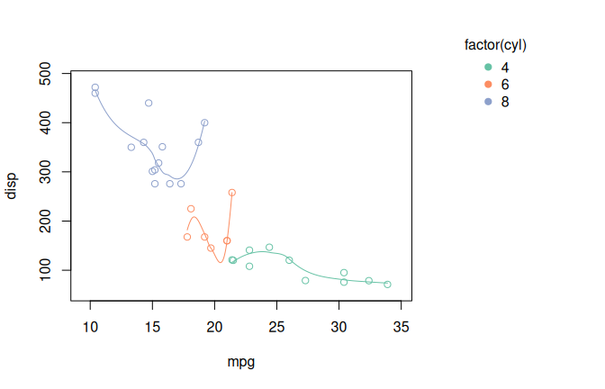

# plotbb: Grammar of Graphics on ‘base’ Graphics


<!-- README.md is generated from README.qmd. Please edit that file -->

Implements a grammar of graphics on top of the ‘base’ graphics system. A
‘bbplot’ object is built incrementally with a ‘+’ operator from data,
aesthetic mappings and layers, then rendered with base graphics, so
plotbb layers can be mixed with ordinary base plotting calls. The
package provides layers for points, lines, bars, histograms, densities,
boxplots, violins, ribbons, smooths, error bars and tiles, together with
colour and other aesthetic scales, automatic legends, faceting, themes,
coordinate flipping and significance annotations.

## Why plotbb?

- A grammar of graphics that renders with **base graphics**: plots stay
  ordinary base plots, with no grid dependency.
- Build a figure incrementally with `+`: layers inherit the plot data
  and mapping, override them locally, and draw in the order they are
  added.
- Mix the grammar with ordinary base calls when a layer does not exist
  yet; there is no separate graphics model to fight.
- Inspect a plot without drawing it (`bb_build()`) and save it without
  disturbing the caller’s device (`bb_save()`).

## Features

- **Grammar**: `bbplot()`, `bb_aes()` and `+` compose data, mappings,
  layers, labels, scales, legends, facets and themes.
- **Layers**: points, lines, text, segments, bars (vertical or
  horizontal, identity or count), histograms, densities, boxplots,
  violins, ribbons, smooths, linear fits, error bars, tiles, reference
  lines and significance annotations.
- **Data and mapping**: global and layer-local data; inherited or
  independent mappings; constants are never sent through a scale.
- **Scales**: colour and fill palettes, manual and gradient scales;
  `pch`, `lty` and `cex`; positional scales for continuous, log10 and
  Date axes, with explicit limits, breaks and labels.
- **Legends**: automatic outside legends, per-layer legends, colour
  bars, minor breaks, bar-style keys and free-colour facets.
- **Facets**: `bb_facet_wrap()` and `bb_facet_grid()`, with free scales,
  labellers, dropped levels and wrapped strip labels.
- **Layout**: `bb_coord_flip()`, themes, titles, axis labels and
  background grids.
- **Extend**: `bb_layer()` for custom statistical layers, `bbplot_add()`
  for package components, and `aplot::plot_list()` for combining
  complete plots.

## Quick start

``` r
library(plotbb)

bbplot(mtcars, bb_aes(mpg, disp, col = factor(cyl))) +
  bb_point() +
  bb_smooth(se = FALSE)
```



## Installation

The development version, which includes the features listed above:

``` r
remotes::install_github("YuLab-SMU/plotbb")
```

A previous release is available from CRAN:

``` r
install.packages("plotbb")
```

## Learn more

- `vignette("plotbb")` is the main guide: it explains the grammar rules
  and works through complete plotting, faceting and extension examples.
- `?bbplot`, `?bb_layer`, `?bb_scale_x_continuous` and `?bb_coord_flip`
  are the reference entry points.
- Complete plots are combined with `aplot::plot_list()`; facets stay
  inside plotbb.

## :writing_hand: Author

Guangchuang YU

School of Basic Medical Sciences, Southern Medical University

<https://yulab-smu.top>

## :sparkling_heart: Contributing

We welcome any contributions! By participating in this project you agree
to abide by the terms outlined in the [Contributor Code of
Conduct](CONDUCT.md).
